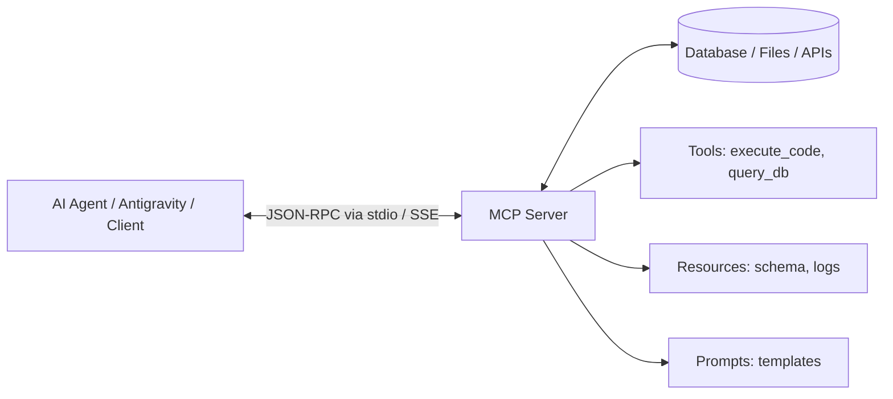

# 🌐 Techtalk 1: MCP? I Hardly Know Her!

**Speaker:** Mr. Weiyuan Liu – Director of Engineering @ Ascenda; Google Developer Expert @ Cloud and AI
**Time:** 13:30 - 14:10

---

## 1. Tổng quan về Model Context Protocol (MCP)

**Model Context Protocol (MCP)** là một chuẩn giao tiếp mở (open standard) được khởi xướng nhằm chuẩn hóa cách các mô hình AI/LLM kết nối an toàn với các nguồn dữ liệu bên ngoài, công cụ (tools), tài nguyên (resources), và môi trường phát triển (IDEs/Agents).

### Vấn đề trước khi có MCP (M x N problem)

- Mỗi mô hình/nền tảng AI lại có một cách định nghĩa Tool Calling, Plugin hoặc Function Calling riêng.
- Muốn kết nối M mô hình AI với N hệ thống dữ liệu (GitHub, Slack, Google Drive, Postgres, BigQuery...) đòi hỏi phải viết $M \times N$ integrations.

### Giải pháp của MCP (M + N solution)

- MCP đóng vai trò như cổng **USB-C cho AI Apps**:
  - **MCP Host / Client:** Ứng dụng AI, Agent, hoặc IDE (ví dụ: Google Antigravity, Claude Code, Cursor).
  - **MCP Server:** Dịch vụ cung cấp dữ liệu hoặc công cụ (ví dụ: BigQuery MCP Server, Git MCP Server, Filesystem MCP Server).
  - Kết nối thông qua giao thức chuẩn JSON-RPC 2.0 (hỗ trợ `stdio` hoặc `SSE - Server-Sent Events`).



---

## 2. Các thành phần cốt lõi của MCP

1. **Tools (Hàm thực thi):**
   - Cho phép Agent thực hiện hành động (Action) có tác động: gọi API, chạy truy vấn SQL, tạo file, kích hoạt build.
2. **Resources (Dữ liệu thụ động):**
   - Đọc dữ liệu chỉ đọc tương tự file hoặc URI: `postgres://schema`, `file:///logs/app.log`.
3. **Prompts (Mẫu ngữ cảnh):**
   - Các template prompt có sẵn giúp người dùng hoặc Agent kích hoạt nhanh tác vụ tiêu chuẩn.

---

## 3. Cách chạy Server MCP mẫu

Trong thư mục này có file `sample_mcp_server.py`.

Để kiểm tra:

```bash
# Kích hoạt venv
..\.venv\Scripts\activate

# Chạy MCP server
python sample_mcp_server.py
```
