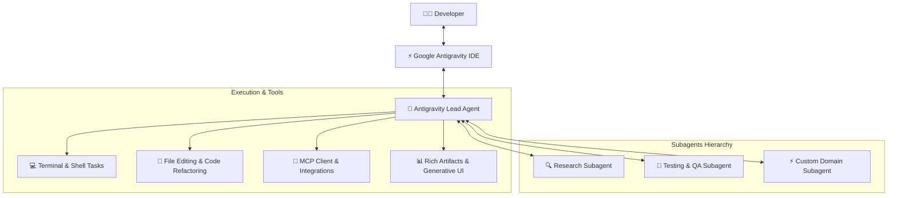

# 🚀 Techtalk 2: Google Antigravity – The Enterprise Agent-first Developer Platform
**Speaker:** Mr. Huy Nguyen – Customer Solutions Consultant @ Google Cloud  
**Time:** 14:10 - 14:25

---

## 1. Google Antigravity là gì?
**Google Antigravity** là nền tảng lập trình Agent-first thế hệ mới được thiết kế bởi Google, biến môi trường IDE truyền thống thành một hệ sinh thái cộng tác giữa lập trình viên và các Autonomous AI Agents.

Khác với các AI Coding Assistant thông thường (chỉ gợi ý code inline hoặc chat thông thường), Antigravity hoạt động như một **Peer Developer (lập trình viên đồng hành)** với đầy đủ năng lực:
- Chủ động nghiên cứu codebase, lập kế hoạch đa bước.
- Thực thi lệnh terminal, kiểm thử và tự sửa lỗi (self-healing loop).
- Điều phối các subagents chuyên biệt (multi-agent orchestration).
- Tích hợp giao thức mở MCP (Model Context Protocol).
- Sinh giao diện động (Generative UI) và các tài liệu cấu trúc (Artifacts).

---

## 2. Các trụ cột chính (Key Pillars)

### A. Agent-First Architecture
- **Autonomous Execution:** Nhận mục tiêu cấp cao (Goal), tự phân rã thành các task con, tự tạo file, chạy kiểm thử, đọc log lỗi và sửa chữa cho đến khi hoàn thành.
- **Background Tasks & Reactive Wakeup:** Chạy các tác vụ dài (build, install packages, tests) trong background mà không chặn luồng chính, tự động thức dậy khi có kết quả.

### B. Artifacts & Generative UI
- Thay vì đẩy hàng ngàn dòng log ra chat làm tràn ngữ cảnh, Antigravity lưu kết quả phân tích, kiến trúc vào các file **Artifacts** markdown độc lập.
- Hỗ trợ rendering đồ họa Mermaid, KaTeX math, bảng so sánh và **Generative UI** widgets tương tác trực tiếp.

### C. Khả năng mở rộng (Customizations & Skills)
- **Skills:** Đóng gói tri thức nghiệp vụ và kịch bản vào các thư mục chứa `SKILL.md`.
- **Rules:** Quy chuẩn lập trình của doanh nghiệp (ví dụ: cấm sửa file config production, bắt buộc viết unit test).
- **Plugins:** Đóng gói toàn bộ skills, MCP servers, hooks và rules vào các plugin có thể bật/tắt chỉ với một click từ Marketplace.

### D. Chuẩn bảo mật doanh nghiệp (Enterprise Guardrails)
- Bảo vệ chống mất dữ liệu ngoài ý muốn (Accidental Data Loss Prevention).
- Xác thực tập trung với Google Cloud ADC (Application Default Credentials), IAM, Workload Identity.
- Nhật ký kiểm toán (Audit Transcripts) minh bạch ghi lại toàn bộ suy nghĩ (Chain of Thought), công cụ được gọi và kết quả.

