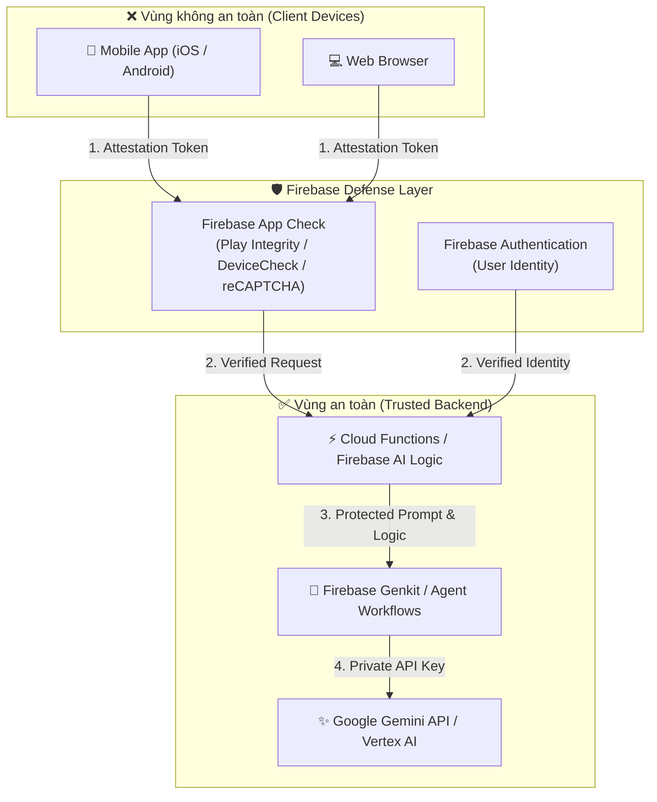

# 🛡️ Techtalk 3: Untrusted Devices, Trusted AI with Firebase AI Logic
**Speaker:** Ms. Cleo – Google Developer Expert @ Firebase, Cloud AI and Google Maps; Engineering Manager @ Factory  
**Time:** 15:15 - 15:55

---

## 1. Bài toán: Rủi ro bảo mật khi gọi AI trực tiếp từ Client (Untrusted Devices)
Trong các ứng dụng di động (Flutter, Android, iOS) hoặc Web, thiết bị của người dùng luôn được coi là **Untrusted (Không đáng tin cậy)** vì:
1. **Lộ API Key:** Nhúng `GEMINI_API_KEY` vào client binary có thể bị decompile (qua `apktool`, `strings` hoặc proxy man-in-the-middle) trong vài phút.
2. **Prompt Injection & Abuse:** Người dùng ác ý có thể sửa đổi prompt, vượt qua safety guards hoặc spam request làm cạn kiệt hạn mức quota và tốn chi phí của chủ dự án.
3. **Bot / Fake Clients:** Kẻ tấn công tạo bot mô phỏng client để trích xuất dữ liệu hoặc lạm dụng AI endpoint.

---

## 2. Giải pháp: Firebase AI Logic & App Check

### A. Firebase App Check (Chứng thực thiết bị)
- Đảm bảo request gửi tới backend bắt buộc phải đến từ **ứng dụng chính chủ** đã được ký số, không phải từ curl, Postman hay emulator đã root:
  - **Android:** Google Play Integrity API.
  - **iOS:** Apple DeviceCheck / App Attest.
  - **Web:** reCAPTCHA Enterprise.

### B. Firebase AI Logic (Server-Side Execution)
- Toàn bộ Prompt template, secret API keys, tool definitions và chính sách kiểm duyệt đều được lưu trữ an toàn trên Google Cloud / Firebase Cloud Functions.
- Client chỉ gửi dữ liệu đầu vào (user input), backend thực hiện kiểm tra quyền (RBAC), gắn thêm context an toàn rồi mới gọi Gemini.

### C. Rate Limiting & User Quotas
- Sử dụng Firebase Auth UID (`request.auth.uid`) để giới hạn:
  - Mỗi user miễn phí tối đa 10 request/ngày.
  - User VIP được dùng mô hình reasoning cao cấp.

---

## 3. Checklist triển khai AI an toàn cho ứng dụng Mobile/Web

- [x] **Không bao giờ** commit hoặc hardcode `GEMINI_API_KEY` vào mã nguồn client.
- [x] Bật **Firebase App Check** trên toàn bộ Cloud Functions và Cloud Run services.
- [x] Áp dụng Schema Validation (với Pydantic / Zod) cho mọi payload người dùng gửi lên trước khi chuyển vào prompt của LLM.
- [x] Cấu hình Budget Alerts và Quota Limits trên Google Cloud Console để phòng ngừa tấn công DoS chi phí.

