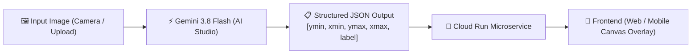

# 👁️ Techtalk 4: Gemini, What Am I Looking At? Shipping a Spatial AI App
**Speaker:** Ms. Nguyen Khanh Linh – Google Developer Expert @ AI/ML; Head of AI @ Obello  
**Time:** 15:55 - 16:40

---

## 1. Spatial AI là gì?
**Spatial AI (Trí tuệ nhân tạo nhận thức không gian)** là năng lực của các mô hình đa phương thức (Multimodal LLMs) như **Gemini 3.8 Flash** không chỉ hiểu nội dung ảnh (như "đây là một chiếc xe hơi") mà còn định vị chính xác vị trí không gian của các đối tượng trong bức ảnh thông qua tọa độ chuẩn hóa (Normalized Bounding Boxes hoặc 3D Keypoints).

### Cấu trúc Bounding Box trong Gemini:
Gemini trả về tọa độ hộp bao chuẩn hóa trong thang đo $[0, 1000]$:
$$[ymin, xmin, ymax, xmax]$$
- $ymin$: Vị trí mép trên của hộp (tính từ đỉnh ảnh)
- $xmin$: Vị trí mép trái
- $ymax$: Vị trí mép dưới
- $xmax$: Vị trí mép phải



---

## 2. Quy trình từ Prototype đến Production

### Bước 1: Thử nghiệm nhanh trên Google AI Studio
1. Truy cập [Google AI Studio](https://aistudio.google.com).
2. Chọn model **Gemini 3.8 Flash** (hoặc Gemini 2.5 Flash).
3. Đặt **System Instruction**:
   ```
   Detect all objects in the image. Return a JSON array with 'label' and 'box_2d' as [ymin, xmin, ymax, xmax] in 0-1000 scale.
   ```
4. Bật **Structured Output (JSON Schema)** để đảm bảo model trả về đúng định dạng mà không cần regex.

### Bước 2: Viết mã nguồn Python với `google-genai`
Xem file thực hành `spatial_demo.py` trong thư mục này.

```python
from google import genai
from google.genai import types
from pydantic import BaseModel

class DetectedObject(BaseModel):
    label: str
    box_2d: list[int]  # [ymin, xmin, ymax, xmax]

client = genai.Client()
response = client.models.generate_content(
    model='gemini-2.5-flash',
    contents=[image, "Detect all prominent objects in this picture."],
    config=types.GenerateContentConfig(
        response_mime_type="application/json",
        response_schema=list[DetectedObject]
    )
)
```

### Bước 3: Đóng gói và Deploy lên Google Cloud Run
Tạo `Dockerfile` nhẹ với FastAPI và triển khai qua một lệnh duy nhất:
```bash
gcloud run deploy spatial-ai-service \
  --source . \
  --region asia-southeast1 \
  --allow-unauthenticated
```
Ưu điểm của Cloud Run:
- **Scale to zero:** Không phát sinh chi phí khi không có người dùng.
- **Cold start cực nhanh:** Khởi động dưới 2 giây.
- **Bảo mật:** Quản lý biến môi trường an toàn thông qua Secret Manager.

