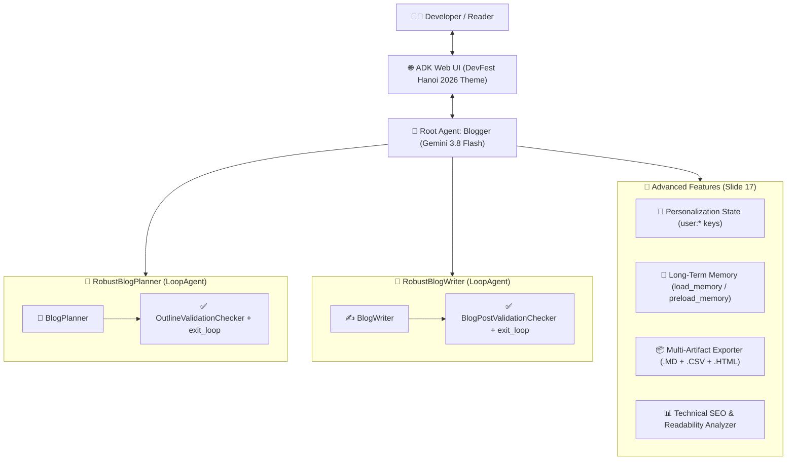

# 🌟 Google DevFest Cloud Hanoi 2026 — AI Agent & Cloud Showcase

[](https://gdg.community.dev/)
[](https://github.com/google/adk-python)
[](https://aistudio.google.com/)
[](https://modelcontextprotocol.io/)

Dự án tổng hợp mã nguồn thực hành, kiến trúc Multi-Agent nâng cao với **Google Agent Development Kit (ADK)**, **Model Context Protocol (MCP)** và **Spatial AI (Gemini 3.8 Flash)** tại sự kiện **GDG DevFest Cloud Hanoi 2026**.

---

## 🏆 Điểm nhấn: Multi-Agent Blogger Studio (`03_Codelab_Google_ADK/bloggeragent`)

Hệ thống Multi-Agent viết blog kỹ thuật được nâng cấp toàn diện dựa trên kiến trúc chuẩn của Codelab kết hợp **3 trụ cột nâng cao (Memory, State & Files)**:



### Các tính năng nổi bật:
1. **🎯 Personalization with `user:` Session State:**
   * Lưu trữ cấu hình tác giả bền vững qua các phiên làm việc (`user:author_name`, `user:writing_style`, `user:language`, `user:target_audience`, `user:tech_stack`).
   * Tự động tiêm (inject) ngữ cảnh cá nhân hóa vào `BlogPlanner` và `BlogWriter` thông qua cú pháp an toàn `{user:author_name?}`.
2. **⚡ Smart Quality Gate với `exit_loop`:**
   * Cả `OutlineValidationChecker` và `BlogPostValidationChecker` đều được trang bị tool `exit_loop`, giúp thoát vòng lặp ngay khi dàn ý/bài viết đạt chuẩn thay vì lặp 3 vòng cố định.
3. **🧠 Long-Term Memory Bank (`load_memory` & `preload_memory`):**
   * Tự động lưu lịch sử phiên làm việc vào bộ nhớ dài hạn qua `after_agent_callback` (`add_session_to_memory`) và hỗ trợ tra cứu lại các chủ đề/bài viết cũ.
4. **📦 Xuất đa định dạng Artifacts (`.md`, `.csv`, `.html`) & Đọc file tải lên (`load_artifacts`):**
   * **File `.md`**: Bản thảo Markdown hoàn chỉnh.
   * **File `.csv`**: Báo cáo phân tích SEO và thống kê cấu trúc từng mục (Section Breakdown, Word Count, Code Snippets, SEO Score).
   * **File `.html`**: Giao diện tạp chí **Google DevFest Cloud Hanoi 2026** 4 màu thương hiệu Google với thẻ điểm SEO trực quan.

---

## 📂 Cấu trúc Repository

```text
├── 01_MCP_Techtalk/                  # Techtalk 1: Model Context Protocol (MCP) Server mẫu
│   ├── README.md
│   └── sample_mcp_server.py
├── 02_Google_Antigravity/            # Techtalk 2: Kiến trúc Google Antigravity Agent-first IDE
│   └── README.md
├── 03_Codelab_Google_ADK/            # Codelab & Buildathon: Xây dựng AI Agent với Google ADK
│   ├── bloggeragent/                 # 🌟 Dự án chính: Multi-Agent Blogger Studio (Nâng cấp)
│   │   ├── agent.py                  # Mã nguồn Multi-Agent + State + Memory + Artifacts
│   │   ├── __init__.py
│   │   ├── requirements.txt
│   │   └── .env.example              # Mẫu cấu hình biến môi trường
│   ├── devfest_assistant_agent/      # Agent trợ lý tra cứu lịch trình & diễn giả DevFest
│   └── starter_agent/                # Agent khởi đầu cơ bản
├── 04_Firebase_AI_Logic/             # Techtalk 3: Bảo mật Client AI với Firebase AI Logic & App Check
│   └── README.md
├── 05_Spatial_AI_Gemini_Flash/       # Techtalk 4: Spatial AI (2D Bounding Boxes) với Gemini 3.8 Flash
│   ├── README.md
│   └── spatial_demo.py
├── .gitignore                        # Bảo vệ tuyệt đối API keys (.env), dữ liệu nhạy cảm & .venv
└── README.md
```

---

## 🚀 Hướng dẫn cài đặt và chạy dự án

### 1. Cài đặt môi trường cho `bloggeragent`
```powershell
cd 03_Codelab_Google_ADK/bloggeragent
python -m venv .venv
.\.venv\Scripts\Activate.ps1
pip install -r requirements.txt
```

### 2. Cấu hình API Key
Sao chép file `.env.example` thành `.env` và điền khóa API từ [Google AI Studio](https://aistudio.google.com/apikey):
```powershell
Copy-Item .env.example .env
# Mở .env và cập nhật GOOGLE_API_KEY của bạn
```

### 3. Khởi chạy giao diện ADK Web UI
```powershell
$env:PYTHONUTF8=1
adk web --port 8000
```
Mở trình duyệt tại **[http://127.0.0.1:8000](http://127.0.0.1:8000)** để tương tác với hệ thống Multi-Agent, xem sơ đồ thực thi (Event Traces), kiểm tra trạng thái (`user:` State) và tải về các Artifacts (`.md`, `.csv`, `.html`).
